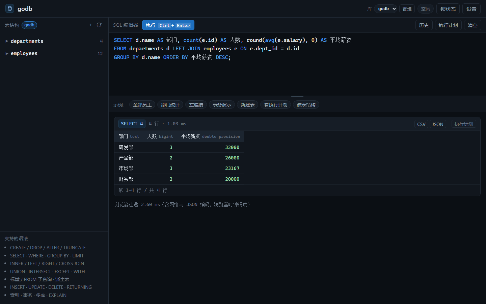

# godb

[](https://github.com/zwccn/godb/actions/workflows/ci.yml)
[](https://go.dev/)

用 Go 从零实现的教学级关系数据库：手写词法分析 → 递归下降语法分析 → 逻辑/物理计划 → 火山模型执行 → 内存行存 + WAL 持久化，并发控制采用**表级 S/X 两阶段封锁**，附带一个内嵌的 Web 控制台。



**零第三方依赖、零 cgo、不直接加载任何系统 DLL**：只用 Go 标准库（`net/http` + `go:embed` + `time`），`CGO_ENABLED=0` 直接编出一个可运行的 exe。

## 快速开始

```bash
cd godb
go build -o godb.exe .
./godb.exe                     # 默认监听 127.0.0.1:8080，数据落在 ./godb-data
```

浏览器打开 <http://127.0.0.1:8080>。首次启动会自动建两张示例表（`departments` / `employees`）并灌入数据。右上角「锁状态」可打开锁面板（`#locks` 直链），「设置」可打开配置页（`#settings` 直链）。

> **端口、远程访问、密码、落盘节奏都在「设置」里改**，不再靠命令行。
> 下面两个 `-http` / `-pg` 只在这个数据目录**第一次**生成 `config.json` 时作为初始值，
> 之后一律以配置文件为准（启动日志会明确提示哪条被忽略了）。

| 参数 | 默认值 | 说明 |
|---|---|---|
| `-http` | `127.0.0.1:8080` | 初始 HTTP 监听地址（仅首次生成配置时使用） |
| `-data` | `godb-data` | 数据目录（catalog / 快照 / WAL / config 都在里面） |
| `-no-sample` | `false` | 首次启动不灌示例数据 |
| `-pg` | `127.0.0.1:6432` | 初始 PG 协议监听地址（仅首次生成配置时使用，留空表示不启用） |
| `-pg-log` | 空 | 把 PG 客户端发来的每条 SQL 追加写到指定文件，排查兼容性问题用 |
| `-isolation` | `table` | `table`＝表级 S/X 锁；`serial`＝全局串行（旧行为，用于对照） |
| `-lock-timeout` | `3s` | 等待表锁的最长时间，超时自动放弃并回滚整个事务 |
| `-lock-retry` | `20ms` | 等待时的轮询间隔（带 ±50% 抖动） |
| `-deadlock-detect` | `true` | 等待成环时让最年轻的事务提前放弃 |
| `-deadlock-after` | `500ms` | 等待多久后开始做死锁检测 |
| `-slow` | `0` | 把耗时超过该值的语句记进日志（如 `-slow 200ms`；0 表示不记录） |
| `-version` | — | 打印版本、汇报的 PG 版本与 Go 版本后退出 |

## 功能

| 类别 | 支持 |
|---|---|
| 持久化 | `CHECKPOINT` / `FLUSH`（强制刷盘 + 全量快照，返回代次与统计） |
| 索引 | `CREATE [UNIQUE] INDEX name ON t (cols)` / `DROP INDEX`——内存 B+Tree，**完整键等值、首列区间（`> < BETWEEN`、`LIKE 'x%'`）、`OR` 合并、`ORDER BY` 免排序都走它**（`SELECT`/`UPDATE`/`DELETE` 都走）；主键也走树，`UNIQUE` 索引参与唯一性校验 |
| 表管理 | `CREATE TABLE`（`SERIAL`、`PRIMARY KEY`（含复合）、`UNIQUE`、`NOT NULL`、`DEFAULT`、`CHECK`）、`DROP TABLE [IF EXISTS]`、`ALTER TABLE ADD/DROP/RENAME COLUMN`、`ALTER TABLE RENAME TO`、`ALTER COLUMN TYPE`、`TRUNCATE` |
| 批量传输 | `COPY t [(列)] FROM STDIN` / `TO STDOUT`（文本格式，`\N` 为 NULL；不支持服务器文件名） |
| 写入 | `INSERT ... VALUES`、`INSERT ... SELECT`、`UPDATE`、`DELETE`；三者都支持 `RETURNING`（含 `RETURNING *`、表达式与别名） |
| 查询 | `SELECT [DISTINCT]`、`WHERE`、`GROUP BY`、`HAVING`、`ORDER BY`（`ASC/DESC/NULLS FIRST/LAST`、别名、序号）、`LIMIT/OFFSET`、`EXPLAIN` |
| 约束 | `NOT NULL`、`UNIQUE`、`PRIMARY KEY`（复合）、`CHECK`、`FOREIGN KEY`（含 `ON DELETE CASCADE`） |
| CTE | `WITH name [(cols)] AS (SELECT ...)`，可多个、可互相引用（物化一次） |
| 集合运算 | `UNION [ALL]` / `INTERSECT` / `EXCEPT`；`FROM` 子查询（含 `AS t(a, b)` 列别名） |
| 集合函数 | `FROM generate_series(a, b[, step])`、`FROM regexp_matches(text, pattern)`，可带列别名列表 |
| 连接 | `INNER` / `LEFT` / `RIGHT` / `CROSS JOIN`，多表串联；等值条件走哈希连接，其余走嵌套循环 |
| 聚合 | `count(*)`、`count(x)`、`sum`、`avg`、`min`、`max`，支持 `DISTINCT` |
| 增删改 | `INSERT ... VALUES`（多行、`DEFAULT`）、`UPDATE ... SET ... WHERE`、`DELETE ... WHERE` |
| 表达式 | 算术 `+ - * / %`、位运算 `& \| #`、比较、`AND/OR/NOT`、`IS [NOT] NULL`、`IN`、`BETWEEN`、`LIKE/ILIKE`、`CASE WHEN`、`CAST`/`::`（含 `information_schema.sql_identifier` 这类带 schema 的类型名）、数组下标 `a[i]`、`\|\|` |
| 函数 | `lower/upper/length/trim/ltrim/rtrim/abs/round/ceil/floor/replace/substring/position/concat/coalesce/nullif/greatest/least/now/regexp_matches` |
| 事务 | `BEGIN`/`START TRANSACTION`、`COMMIT`、`ROLLBACK`；语句级原子性；崩溃恢复 |
| 并发 | 表级 `S`/`X` 锁、严格两阶段封锁、锁等待与超时、等待图死锁检测 |
| 类型 | `smallint/integer/bigint/serial/bigserial/numeric(p,s)/real/double precision/text/varchar(n)/char(n)/boolean/date/timestamp` |
| 接入 | 内嵌 Web 控制台（HTTP/JSON，表树支持右键菜单与表设计器）+ **PostgreSQL wire protocol v3**（psql / Navicat / pgAdmin 可直连） |

**明确不支持**（会报清晰的错误）：递归 CTE（`WITH RECURSIVE`）、窗口函数、
`FULL JOIN`、`NATURAL JOIN`、行级锁。

索引能处理：完整键等值、首列区间（`> < >= <= BETWEEN`、`LIKE 'x%'`）、
`OR` 的多点/多区间合并、以及命中索引列前缀的 `ORDER BY`（免排序，可反向）。
**还不能**做 `IN` 列表合并（`IN` 走的是全表扫）、`OR` 里跨索引的合并（要求所有分支
落在同一个索引上）、以及非首列的范围（`(a,b)` 索引上 `b > 5` 用不上）。
没有索引跳跃扫描，也没有覆盖索引 —— 结果一定对，只是慢。

**支持标量子查询**（`(SELECT ...)` 出现在表达式位置，返回单列、可以引用外层列）。
这不是为了 SQL 完整性，而是客户端刚需：Navicat 刷新对象树时会发
`(SELECT count(*) FROM pg_inherits WHERE inhparent = c.oid) > 0`，不支持就整个表列表刷不出来。

## 表管理（右键菜单 + 表设计器）

Web 控制台左侧的表树支持右键菜单，照着 Navicat 的习惯做的。菜单动作不新增后端接口，
全部由前端生成 SQL 走 `/api/query` —— 报错就是真实的 SQL 报错，也算教学的一部分。

| 菜单项 | 生成的语句 |
|---|---|
| 打开表 | `SELECT * FROM t LIMIT 100` |
| 设计表 | 打开表设计器，保存时按差异生成下面几种 `ALTER` |
| 新建表… | `CREATE TABLE`（表设计器，空表起步） |
| 重命名… | `ALTER TABLE t RENAME TO t2` |
| 复制表结构… | 用 `/api/schema` 反推 `CREATE TABLE`（**不复制数据**，引擎不支持 `INSERT ... SELECT`） |
| 清空数据 | `TRUNCATE TABLE t` |
| 删除表 | `DROP TABLE t` |
| 刷新列表 | 重新拉 `/api/schema` |

表树空白处右键只有「新建表 / 刷新列表」，侧栏标题旁的 `+` 也是新建表。

### 表设计器

表格化的列编辑器：名 / 类型 / 长度 / 小数点 / 不是 null / 主键 / 唯一 / 默认值，
顶部有「添加字段、删除字段、设为主键」，右侧「SQL 预览」实时显示将要执行的语句（Ctrl+Enter 保存）。

保存时按原结构与当前编辑的差异生成语句，顺序是：改表名 → 改列名 → 改类型 → 加列 → 删列。
因为 `ALTER COLUMN TYPE` 认的是当前列名，所以改名必须排在改类型之前。

**能力边界**（引擎限制，设计器里会以注释形式提示「已忽略」，不会静默丢改动）：

- 已有列的 `NOT NULL` / `DEFAULT` / `UNIQUE` 改不了（引擎没有 `ALTER COLUMN SET ...`）。
- 主键不能给已有表后加，也不能取消；新建表时可以设，且只支持单列主键。
- 事务未结束时禁止 DDL（`DDL 不能在事务里执行`），设计器保存前会先拦一下。

## 控制台的其他能力

| 能力 | 说明 |
|---|---|
| 结果导出 | 每个结果块右上角有 `CSV` / `JSON` 按钮，直接下载（CSV 带 BOM，Excel 打开中文不乱码） |
| 结果分页 | 每页 50/100/200/500 行可切，翻页只重渲染、不重新查库；不再是「超过 300 行就截断」 |
| SQL 历史 | 编辑器右上「历史」，最近 30 条存 `localStorage`，点一条回填编辑器 |
| `SHOW` / `SET` | 和 PG 协议走同一条执行路径（`sql.Show` + `exec.ShowResult`），网页里也能 `SHOW server_version` |
| 表树 | 默认只到表级，点 `▶` 展开字段；展开状态在刷新后保持 |

> `SHOW` 只覆盖客户端常问的那几个参数（`server_version`、`encoding`、`search_path`、
> `block_size`…），不认识的返回空串而不是报错——客户端只是拿它做探测。
> `SET` 一律确认，godb 不保存任何会话参数的状态。

## 构建与发布

```bash
# 本机（注意 GOARCH：这台机器默认是 386，且上级目录有 svn，要关掉 VCS 探测）
CGO_ENABLED=0 GOOS=windows GOARCH=amd64 go build -buildvcs=false -ldflags "-s -w" -o godb.exe .
```

打 `v*` 标签会触发 `release` workflow：交叉编译 windows / linux / darwin（amd64 + arm64）六个单文件，
附上 `SHA256SUMS.txt` 挂到对应的 GitHub Release。

## 并发控制（表级两阶段封锁）

### 语义

对每张表独立判定「这个事务在这张表上是读还是写」：

| 我这个事务对表 t 做了什么 | t 上加的锁 | 别人能读 t | 别人能写 t |
|---|---|---|---|
| 读过 | `S`（共享） | ✓ | ✗ |
| 写过 | `X`（排它） | ✗ | ✗ |
| 先读后写 | `S` 升级为 `X` | ✗ | ✗ |

- 锁从第一次触达该表起持有，**到 COMMIT/ROLLBACK 才释放**（严谨两阶段封锁，rigorous 2PL），因此隔离级别等价于 **SERIALIZABLE**：脏读、不可重复读、幻读都不可能。
- 两个事务的表集合不相交时**完全并行**（事务 A 改 `t1`、事务 B 改 `t2` 互不影响）。
- 同一张表上：读读并发 ✓、读写互斥 ✗、写写互斥 ✗。

### 保守预扫描：把死锁消掉

控制台通常把 `BEGIN; …; COMMIT;` **整批**发给服务端，服务端手上有全部语句，于是可以：

1. 静态扫一遍整批，得出每张表是「只读」还是「要写」；
2. `BEGIN` 那一刻**一次性申请全部表锁**（保守 2PL）。

这样既不会中途发生 `S → X` 升级（升级冲突是死锁的主要来源），也不会出现双方交叉加锁的环。逐条交互式提交时做不到预判，才会退化成增量加锁，此时靠等待图检测兜底。

### 拿不到锁怎么办

1. 立即尝试授予；冲突则等待，每 `20ms`（±抖动）重试一次，期间**不释放**已持有的锁。
2. 等待超过 `-lock-timeout`（默认 3s）→ **整个事务自动放弃**：回滚、释放全部锁、返回错误并指出是谁卡着、卡在哪张表。
3. 等待超过 `-deadlock-after`（默认 500ms）→ 扫一次等待图；若成环，让环里**最年轻**（序号最大）的事务放弃，其余继续。

错误长这样：

```
等待锁超时（已等 3.008s）：表 employees 被 4f0b55(S) 持有
检测到死锁（等待环涉及 2 个事务：8262bb → 4f0b55），本事务被回滚，请重试
```

### 锁面板

右上角「锁状态」实时显示每张表的持有者（`S: 会话1、会话2` / `X: 会话3`）、正在等待的事务、累计等待次数。测试并发要用**两个浏览器窗口/无痕窗口**（同一浏览器的多个标签共享 cookie，等于同一个会话）。

### 实测开销

`go test ./db -run XXX -bench . -benchtime=300x`（2000 行表，同一张表、同一条聚合查询）：

| 场景 | 耗时 | 说明 |
|---|---|---|
| 单会话，`-isolation=serial` | 268 µs/op | 全局锁 |
| 单会话，`-isolation=table` | 264 µs/op | 表级锁，**开销在噪声内** |
| 8 路并发纯读 | 55 µs/op | 读读相容，约 **4.9×** 吞吐 |
| 4 路并发写同一张表 | 411 µs/op | 互斥，被表锁串行化 |
| 4 路并发写不同表 | 375 µs/op | 只快 9%，瓶颈是 **WAL fsync**，不是锁 |
| 4 路并发写不同表（组提交后） | 约 1670 提交/秒 | fsync 合并率 1.06x，瓶颈转移到提交临界区 |

补充一个实测：20000 行一次性 `INSERT` 从 12.8s 优化到 **0.152s**（约 85×）。
原因是语句内唯一性检查原本对每行扫描已插入的行（O(n²) 且每次都编码字符串），
改成「语句内用局部哈希集合 + 只扫描本语句之前插入的行」后是 O(n)。

结论：加锁本身的开销可以忽略（每条语句 0.2µs 量级，而一条查询是几百 µs）。做了组提交之后，写并发的瓶颈从 `fsync` 转到了**提交临界区**（应用写集 + 重建主键索引），这已经和锁、也和日志格式无关了。

### 内存占用：一个 Value 从 72 字节压到 32 字节

行数据全驻内存，`Value` 的大小直接乘上行数。早期版本让 int64 / float64 / bool / time.Time 各占一个字段，一个 `Value` 就是 72 字节（`time.Time` 自己占 24），4 列的表一行要 300 多字节。

现在只保留一个 8 字节槽位按类型复用：

| 类型 | 存储方式 |
|---|---|
| `INTEGER` / `BIGINT` | `I` = 整数值 |
| `NUMERIC` / `DOUBLE` | `I` = `float64` 的位模式 |
| `BOOLEAN` | `I` = 0 / 1 |
| `TIMESTAMP` | `I` = UnixNano，另有一个 `int16` 存时区偏移（分钟） |
| `TEXT` | `S`（字符串头） |

实测 40 万行 4 列：**138 MB → 85 MB**（363 → 224 字节/行，-38%），插入耗时不变。

### 持久化层的改动效果（5 万行数据）

| 指标 | 改动前 | 改动后 |
|---|---|---|
| 批量插入 5 万行 | 423 ms | **186 ms** |
| WAL 体积 | 约 90–120 字节/行（JSON） | **65 字节/行**（二进制帧） |
| `ALTER TABLE ADD COLUMN` | 92 ms（含全量快照） | **20 ms**（不重写快照） |
| 全量 checkpoint | 66 ms | **46 ms** |
| 冷启动（加载 5 万行） | 212 ms | **132 ms** |

## 设置页（落盘节奏 / 端口 / 密码）

控制台右上角「设置」打开，或直接访问 `/#settings`。配置**唯一来源**是数据目录下的
`config.json`（原子写：tmp + fsync + rename），改完立即生效，不需要重启。

### 落盘节奏

`checkpoint` 的三条触发条件，**任一满足**就写快照 + 轮转 WAL：

| 配置项 | 默认 | 含义 |
|---|---|---|
| `storage.checkpointCommits` | `128` | 每多少次提交 |
| `storage.checkpointSeconds` | `60` | 每隔多少秒（有改动才真写） |
| `storage.checkpointWalMB` | `64` | WAL 涨到多少 MB |

填 `0` 表示关闭该条；三条全填 `0` 就只剩手动 `CHECKPOINT` 和正常退出会落盘（页面会警告）。

**提交时的 `fsync` 不在这里配**：它始终同步执行（组提交只是把并发事务的 fsync 合并），
关掉就等于放弃「COMMIT 成功即持久」。设置页只调「多久把内存整理成快照、把 WAL 收回空文件」。

页面还会显示累计落盘次数、上次落盘距今多久、之后已提交多少、当前 WAL 大小，方便判断配置是否符合预期。

### 网络

| 配置项 | 默认 | 说明 |
|---|---|---|
| `network.httpPort` | `8080` | 控制台端口 |
| `network.httpRemote` | `false` | `false` 只绑 `127.0.0.1`；`true` 绑 `0.0.0.0` |
| `network.pgEnabled` | `true` | 是否启用 PostgreSQL 协议 |
| `network.pgPort` | `6432` | PG 协议端口 |
| `network.pgRemote` | `false` | 同上 |

改端口 / 开关远程是**热切换**：关掉旧 listener、绑新地址，进程不退出、数据不重新加载，
绑失败（端口被占）会自动回滚旧地址并在页面上报错。正在执行的请求不受影响，但
**控制台端口变了之后需要用新端口重新打开页面**（页面会提示新地址）。

> 开了远程访问后如果还是连不上，多半是 Windows 防火墙没放行，例如：
> `netsh advfirewall firewall add rule name="godb 8080" dir=in action=allow protocol=TCP localport=8080`

### 密码

只保护 **PostgreSQL 协议**：启用后客户端必须输入用户名 + 密码，服务端发
`AuthenticationCleartextPassword`，密码以 **PBKDF2-HMAC-SHA256（12 万次迭代）** 哈希存在
`config.json` 里，接口永远不会回显密码或哈希，只能重设。密码错误返回 `28P01` 并断开。

```bash
PGPASSWORD=你的密码 psql -h 127.0.0.1 -p 6432 -U godb -d godb
```

Navicat / pgAdmin 里把「密码」填上即可（用户名要与设置页填的一致）。

两个必须知道的边界：

1. **网页控制台不登录**。能打开控制台的人可以执行任意 SQL，所以不要把控制台暴露到不可信网络。
2. **配置的写操作只接受本机请求**（`127.0.0.1` / `::1`）。开了远程访问之后，远程能看设置页
   但改不了——否则任何人都能把 PG 密码关掉。
3. PG 协议**没有 TLS**，密码是明文传输（协议本身的 cleartext 认证）。跨公网请套 SSH 隧道或 VPN。

## 用 PostgreSQL 客户端连接

除了自带的 Web 控制台，godb 还实现了 **PostgreSQL 前端/后端协议 v3**，可以直接用 PG 客户端连：

```bash
# psql
psql "host=127.0.0.1 port=6432 user=zwccn dbname=godb sslmode=disable"
```

| 客户端 | 连接参数 |
|---|---|
| psql / pgcli | `-h 127.0.0.1 -p 6432 -U 任意用户名 -d godb` |
| Navicat / pgAdmin / DBeaver | 主机 `127.0.0.1`，端口 `6432`，初始数据库 `godb`，用户名随意，**密码留空** |

协议实现范围：

| 能力 | 状态 |
|---|---|
| 启动握手、`SSLRequest`（回 `N` 回落明文）、trust 认证（无密码） | ✅ |
| 简单查询 `Q`（支持多语句，逐条返回结果集） | ✅ |
| 扩展查询 `P/B/D/E/S/C/H`，含 `$1` 文本与二进制参数 | ✅ |
| `RowDescription` 带 PG 类型 OID（int4/int8/text/bool/float8/numeric/timestamp…） | ✅ |
| 错误 `ErrorResponse` 带 SQLSTATE（`42P01` 表不存在、`23505` 唯一键、`40P01` 死锁、`55P03` 锁超时…） | ✅ |
| 事务状态 `ReadyForQuery` 的 `I`/`T`/`E` | ✅ |
| `SET` / `SHOW` / `version()` / `current_schema()` 等客户端探针 | ✅ 内置垫片 |
| 密码认证（md5 / SCRAM） | ❌ |
| `pg_catalog` / `information_schema` 系统目录 | ✅ 用虚拟表实现，见下节 |
| 标量子查询 `(SELECT ...)` | ✅ 含相关子查询；多行会报 `more than one row` |
| `FROM` 子查询、`UNION`/`INTERSECT`/`EXCEPT` | ✅ 客户端触发器页的查询需要 |
| `IN`/`EXISTS` 子查询、CTE、窗口函数 | ❌ |
| 括号联接组 `LEFT JOIN (a JOIN b ON …) x ON …` | ✅ 客户端刷对象树必需 |

> 注意端口：默认用 `6432`，因为本机 `5432` 往往已经被真正的 PostgreSQL 占用。

### 系统目录（虚拟表）

客户端连上后第一件事就是读 `pg_catalog`，不实现它们会直接报
`relation "pg_database" does not exist`。godb 在 `syscat/` 里把这些目录做成
**虚拟表**：不落盘、只读，行数据在查询时由当前 catalog 实时生成。

已实现 `pg_catalog` 下的：`pg_database`、`pg_namespace`、`pg_class`、`pg_attribute`、
`pg_type`、`pg_index`、`pg_constraint`、`pg_attrdef`、`pg_am`、`pg_tablespace`、
`pg_roles`/`pg_user`/`pg_shadow`/`pg_authid`/`pg_group`、`pg_settings`、`pg_description`、
`pg_inherits`、`pg_enum`、`pg_range`、`pg_collation`、`pg_extension`、`pg_proc`、
`pg_language`、`pg_trigger`、`pg_rewrite`、`pg_depend`、`pg_operator`、`pg_cast`、
`pg_opclass`、`pg_opfamily`、`pg_conversion`、`pg_policy`、`pg_publication`、
`pg_sequence`、`pg_partitioned_table`、`pg_statistic`、`pg_statistic_ext`、
`pg_foreign_*`、`pg_user_mapping`、`pg_event_trigger`、`pg_subscription`、
`pg_replication_origin`、`pg_largeobject_metadata`、`pg_seclabel`、`pg_shdepend`、
`pg_ts_*`，以及视图 `pg_tables`、`pg_views`、`pg_matviews`、`pg_indexes`、
`pg_sequences`、`pg_stat_activity`、`pg_locks`、`pg_prepared_statements`、
`pg_prepared_xacts`、`pg_cursors`、`pg_timezone_names`、`pg_available_extensions`、
`pg_stat_user_tables`、`pg_stat_all_tables`、`pg_stat_database`、`pg_stat_user_indexes`。

`information_schema` 下的：`schemata`、`tables`、`columns`、`table_constraints`、
`key_column_usage`、`constraint_column_usage`、`referential_constraints`、`views`、
`sequences`、`routines`、`parameters`、`triggers`、`domains`、`table_privileges`、
`column_privileges`、`character_sets`、`collations`、`check_constraints`、
`element_types`、`sql_features`。

为了让这些查询能跑，SQL 层还补了客户端实际用到的东西：

| 语法/函数 | 例子 |
|---|---|
| schema 限定表名 | `FROM pg_catalog.pg_class c` |
| schema 限定函数名 | `pg_catalog.format_type(...)`、`pg_catalog.set_config(...)` |
| 数组字面量与成员判断 | `relkind = ANY (ARRAY['r','p'])`、`x <> ALL (…)` |
| 正则运算符 | `nspname !~ '^pg_'`、`~`、`~*`、`!~*` |
| 目录函数 | `format_type`、`pg_get_expr`、`pg_get_userbyid`、`pg_encoding_to_char`、`pg_table_is_visible`、`has_table_privilege`、`current_schemas`、`quote_ident`、`pg_size_pretty` 等 100 多个（见 `exec/compat.go`） |

写入保护：对系统目录做 `INSERT/UPDATE/DELETE/DROP` 会报
`permission denied: "pg_class" is a system catalog`；查询它们也不会加表锁。

**排查工具**：如果某个客户端还有语句跑不通，启动时加 `-pg-log ./pg-queries.log`，
把客户端发来的每条 SQL 原样记下来，就能知道缺哪块。

## 耗时显示

每条语句的结果卡右上角会显示它自己的耗时，粒度到微秒：

```
SELECT 5    5 行 · 14.1 ms
```

- 服务端只用了标准库 `time`（`hrtime` 包，见下），不涉及 cgo 或系统 DLL。
- 服务端耗时**含等待锁**、**不含 SQL 解析**，鼠标悬停可以看到精确到纳秒的原值和本机时钟步进。
- 浏览器还会显示一个「往返」耗时（`performance.now()` 测的，含网络与 JSON 编码），用来交叉验证。

**关于精度的一句实话**：`time.Now()` 的分辨率取决于操作系统时间源。正常电脑上是亚微秒到微秒级，
但本项目的开发沙箱里时钟步进约 **0.2 ms**，所以比它更快的操作测不出来。服务端启动时会实测这个步进，
前端把测不准的值显示成 `<0.20 ms` 而不是骗人的 `0 ms`：

```
SELECT 1    1 行 · <0.20 ms
```

要看到真实的微秒级数字，跑一条耗时超过时钟步进的查询即可（例如 `big` 表上的 `ORDER BY`）。

## 架构

```
main.go        启动装配、参数解析
  db/          会话管理、语句分发、事务控制、整批预扫描、示例数据
  sql/         lexer → parser → AST（递归下降 + Pratt 表达式优先级）
  lock/        表级 S/X 锁管理器：批量原子申请、等待重试、超时、等待图
  catalog/     表/列元数据，catalog.json 持久化
  hrtime/      计时入口（只用标准库 time，无 cgo / 无 DLL），含时钟步进探测
  types/       值（Datum）、类型系统、CAST、比较/哈希
  storage/     内存堆表 + B+Tree 索引（主键/UNIQUE/二级）+ 写集事务 + WAL + 快照
  txn/         会话状态、隔离模式、语句级回滚、持锁集合
  exec/        表意图分析、计划构建、表达式编译、算子（Scan/Filter/Join/Agg/Sort/…）
  web/         HTTP API + go:embed 内嵌前端（原生 JS，无构建步骤）
```

执行链路：`SQL 文本 → Lex → Parse(AST) → TableIntents(要锁哪些表) → 拿锁 → BuildSelect(算子树) → Open/Next 拉取行 → JSON → 前端表格`。

### 并发实现要点

- **锁持有期**：`S`/`X` 都持到事务结束（这就是 rigorous 2PL，也是可串行化的保证）。
- **加锁顺序**：`SchemaMu（读）→ CommitMu → 锁管理器内部锁`，全程单向，不会互相等待。
- **schema 锁**：语句执行期间持 `SchemaMu` 读锁（保护 catalog 与表数据；DDL 持写锁），但**表锁的等待发生在拿 schema 锁之前**，避免一个 DDL 把所有人堵在门口。
- **提交串行化**：`CommitMu` 串行化「写日志 + 应用写集」。**fsync 在锁外做**，并发事务的 fsync 会合并（组提交）。
- **语句级回滚**：每条语句执行前 `tx.Mark()` 浅拷贝写集，出错就 `RestoreTo`。

### 索引

三种索引都是内存 **B+Tree**（`storage/btree.go`）：`TableData.pk` 存主键，
`TableData.second` 存用户建的索引（索引名 → 树），`TableData.unique` 存列级 `UNIQUE` 的组
（列组签名 → 树）。节点就是一个「页」（最多 256 个键），2 层覆盖 6.5 万行、4 层覆盖 16 亿行；
叶子之间用 `next` 串成链表，范围扫描沿它顺序走。

- **为什么不用哈希表**：等值够用，但 `BETWEEN`、`> <`、`LIKE 'x%'`、`ORDER BY` 全都用不上。
  键有序之后这些都能变成「定位一次 + 顺序读」。
- **为什么不用跳表**：跳表的优势建立在「指针跳转不花钱」上，只成立在全内存。数据一旦
  超过内存，链表指针就是随机 IO。B+Tree 的节点天然等于磁盘页，将来接 buffer pool 时
  只需换掉节点的读写，树逻辑不用动。
- **键编码有两套**：`types.Key` 无歧义但不保序（int 用十进制字符串，`"10" < "9"`），
  只用于 WAL/快照这类编码；`storage/orderKey` 才是保序的 —— int/时间用大端加符号位翻转、
  float 用 IEEE754 位技巧、文本用转义 + `0x00` 终止（长度前缀会破坏顺序）。
  `-0.0` 在两套编码里都归一成 `0.0`。
- **删除用延迟合并**：只从叶子摘键，不做兄弟借位/节点合并；空叶占比超过 30% 时整树重建
  （本库重建很便宜）。省掉约 300 行最容易写错的合并逻辑。

含 NULL 的行不进索引 —— `col = NULL` 永远不成立，放进去只会多捞行。

- **什么时候建**：加载表时整表重建一次，之后**增量维护**——改一行只删一个旧键、插一个新键。
  这依赖「行槽位稳定」（见下一节）；只有 `ALTER TABLE`、新建索引、`TRUNCATE`、WAL 重放
  这些会让行号整体变化的操作才整表重建。
- **事务视角**：索引里是「已提交态」，查的时候逐行过一遍 `tx.Get` 并重新校验键值
  （本事务可能已把这行改成别的值），再从 overlay 补本事务新插入/改键的行。
  少了任何一边都会出现「事务内刚插的行自己查不到」或「已删的行又被索引捞回来」。
- **什么时候用**：单表查询，四种情况
  1. **完整键等值**：索引的每一列都有 `列 = 常量`，主键优先，多个候选取列最多的；
  2. **首列区间**：`> >= < <= BETWEEN`，以及前缀 `LIKE 'abc%'`（中间有 `%`/`_` 就不认，
     否则会漏行）。多列索引 `(a,b)` 上 `a` 的区间会翻译成键上的前缀区间
     （`a > 5` → 下界抬到 `enc(5)+0xFF`，因为下一列的编码从类型标签开始，远小于 0xFF）；
  3. **`OR` 合并**：顶层 OR 的每个分支都能翻译成同一个索引上的键区间时，合成一次
     「多区间扫描」（`Index Union Scan`）。要求很严：**每个**分支都得落在同一个索引上，
     有一个用不上就整条放弃 —— 部分命中等于漏行。区间重叠会被去重；
  4. **`ORDER BY` 命中索引列前缀**：行已经是索引序，直接省掉排序（见下）。

  `SELECT` 走索引扫描算子，`UPDATE`/`DELETE` 用同一套选择逻辑取候选行。索引只缩小候选集，
  `WHERE` 仍由 filter 再判一遍——重复判一次的代价可以忽略，换来的是「就算这里对类型
  做了错假设也不会返回错的行」。
- **`ORDER BY` 免排序**：索引顺序扫描 + `ORDER BY` 正好是索引列的**前缀**且方向一致时，
  不建 `Sort` 节点。`DESC` 靠反向遍历同一批行实现（不是另一棵树）。三个前提：
  隔着 `filter` 看下去是索引扫描、排序列是索引列前缀且顺序一致、所有排序列同方向
  （索引只能整体正扫或反扫，`a ASC, b DESC` 做不到）。
  **没有 `WHERE` 时不走这条路**：索引里不含 NULL 键，拿索引当「全表顺序」会漏掉
  该列为 NULL 的行。
- **区间扫描是流式的**：`indexRangeScanOp` 持一个游标（`storage.IndexScanner`），
  上层要一行才走一步，**不是先把整个区间物化再吐**。所以 `ORDER BY ... LIMIT 10`
  只碰前面几个叶子：20 万行的区间取前 10 行是亚微秒级，而不是先扫完 20 万行。
  叶子链是**双向**的（`next` + `prev`），`DESC` 从右端往回走，同样能提前停。
  事务里有写集时退回物化（要和本事务插入/改键的行归并），代价只落在真正写过数据的会话上。

  这条不只对 `LIMIT` 有用：`UPDATE`/`DELETE` 走的是同一套索引选择，但它们本来就要
  扫完整个候选集，没有提前停的余地。
- **和 DDL 的关系**：`CREATE INDEX` 建完会立刻把已有数据灌进索引；`DROP COLUMN`
  连带删掉引用该列的索引；`RENAME COLUMN` 同步改索引里的列名；其他 `ALTER`
  统一重建一次（列位置或类型变了，旧键就失效了）。

实测（5 万行、3 列，走 HTTP 接口，取三次中最快的一次）：

| 查询 | 耗时 |
|---|---|
| `WHERE id = 49999`（主键） | 低于计时精度（<0.24 ms） |
| `WHERE code = 'c49999'`，**没建索引** | 3.11 ms |
| `WHERE code = 'c49999'`，建了索引 | 低于计时精度（<0.24 ms） |
| `WHERE qty > 10`（范围，索引不适用） | 3.08 ms |

也就是 ≥13 倍。但这个「倍数」要打个折：绝对值 3 ms 本来就在人的感知阈值以下，
几十万行的规模下索引省的是**单条查询的时间**，不是体感。

20 万行的 `(a,b)` 索引 + `code` 索引上（取 5 次最好）：

| 查询 | 耗时 | 说明 |
|---|---|---|
| `WHERE a BETWEEN 100 AND 199 ORDER BY a, b`（2 万行） | 8.77 ms | 索引序，无 `Sort` |
| 同上但 `ORDER BY b` | 23.11 ms | 排序列用不上索引，多花 14 ms 排序 |
| 同上 + `LIMIT 10` | 低于计时精度 | 游标只走前几个叶子 |
| `WHERE id = 3 OR id = 7 OR id = 11` | 低于计时精度 | `Index Union Scan`（3 ranges） |
| `WHERE id < 50 OR id > 199950` | 低于计时精度 | 两段区间一次扫 |
| `WHERE id = 3 OR note = 'n5'` | 22.51 ms | 有分支没索引 → 退回全表扫 |

区间命中 20 万行时，取多少行就干多少活（`(a,b)` 索引上 `ORDER BY a, id`）：

| 查询 | 耗时 |
|---|---|
| `... ORDER BY a, id LIMIT 1` / `LIMIT 10` / `LIMIT 100` | 低于计时精度 |
| `... ORDER BY a DESC, id DESC LIMIT 10`（反向游标） | 低于计时精度 |
| `... ORDER BY a DESC, id DESC LIMIT 100000` | 34.9 ms |
| `... LIMIT 200000`（全取） | 56.5 ms |
| `... ORDER BY code LIMIT 10`（`code` 无索引，要全取再排） | 334 ms |

最后一行是对照：排序必须看到全部行才能给出前 10 条，那是 `Sort` 的固有成本，
和索引扫描没关系。想让这种查询也快，得把 `code` 建进索引。

换成 B+Tree 之后，20 万行上的区间查询也不再有全表扫的份：

| 查询（20 万行） | 耗时 |
|---|---|
| `WHERE id BETWEEN 100 AND 200`（主键区间，101 行） | 低于计时精度 |
| `WHERE qty > 199000`（二级索引区间，999 行） | 低于计时精度 |
| `WHERE code LIKE 'c999%'`（前缀，200 行） | 低于计时精度 |
| `WHERE note > 'n199998'`（`note` 无索引，全表扫） | 24.7 ms |

写路径以前才是真瓶颈：每次提交都要重组整表行切片 + 重建所有索引，
20 万行的表改一行要 40 ms（带两个二级索引是 158 ms）。解决办法是让行槽位稳定下来。

### 行槽位与写路径

`TableData.Rows` 是**槽位数组**，删除只把槽位置 `nil` 并记进 `free`，不搬动后面的行。
槽位稳定了，索引里的「槽位号」在两次提交之间就一直有效，于是：

- **提交只碰写集**：删除 = 摘掉索引键 → 置空槽 → 槽位进 `free`；更新 = 原地替换槽位
  （键变了才换索引键）；插入 = 从 `free` 取一个空槽或追加。成本 O(改动行数)，
  与表大小无关。
- **空槽会被复用**：下一次插入优先填空槽，数组不会因为反复删插无限变长。
- **磁盘上永远紧凑**：`writeTableSnap` 跳过空槽、文件头记真实行数；加载回来就是
  连续行号，不需要再压一次。
- **`ALTER TABLE` 前先压实**：`ALTER` 按下标重写每一行，空槽必须清掉，否则会被当成
  「全默认值的一行」写回去，行数凭空多出来。
- **整表清空会释放数组**：`TRUNCATE` / 全表 `DELETE` 之后 `Rows` 直接置空。

实测（20 万行 4 列 + 主键 + 2 个二级索引，走 HTTP 接口）：

| 操作 | 改之前 | 改之后 |
|---|---|---|
| 单行 `UPDATE` | 41 ms（无二级索引）/ 158 ms（带 2 个） | **1.3–1.4 ms** |
| 改索引列的 `UPDATE` | 同上 | 1.4 ms |
| 单行 `INSERT` | 同上 | 1.3 ms |
| 按索引点查 | 1.1 ms | 1.1 ms |
| 删 10 万行 | — | 238 ms（约 2.4 µs/行） |

剩下这 1.3 ms 基本是 SQL 解析、表锁和 WAL `fsync`，已经不是存储层的锅了。

代价与边界：

- 空槽不会自动回收（除了 `TRUNCATE` 和 `ALTER`）：反复「删一大批再断续插」会让
  `Rows` 长期长于实际行数，扫描要跳过 nil。用 `Live` 而不是 `len(Rows)` 报行数就不会算错。
- 低基数列上的二级索引，删除一行要从「键 → 槽位列表」里摘一个槽位，最坏 O(同键行数)。
  仍远好于整表重建，但别在一个值占全表的列上建索引指望写快。
- 快照写盘前要拷一份槽位数组（指针数组，20 万行约 3 ms）：提交是原地替换槽位，
  直接引用会让写盘读到半新半旧的行。所以 checkpoint 的锁内成本变成「拷贝 + 更新几个 map」，
  不再是「序列化整表」。

### 事务与崩溃恢复

1. 写操作先落到事务私有写集（overlay），提交时才应用。
2. 提交：先把整批行变更写进 WAL（二进制帧），再按写集**增量**应用到内存（只碰改动的那几行和几个索引键），最后 `fsync`。客户端收到 `COMMIT` 成功时数据一定已经落盘。
3. 恢复：启动时 `snapshot.json` + 重放 `wal.log` 中**带 commit 标记**的事务，未提交的直接丢弃 —— 这就是原子性。重放完立刻 checkpoint 并轮转 WAL。
4. 中毒事务：语句出错后会话进入 aborted 状态，后续语句一律被拒绝，只能 `ROLLBACK`（`COMMIT` 等价于回滚），与 PostgreSQL 一致。**但锁冲突是例外**：按“超时即放弃”的约定，直接回滚整个事务并释放锁。

### 为什么 DDL 不能在事务里执行

`ALTER TABLE` 要改写所有现存行，如果允许回滚，就会出现"表结构变了但数据宽度没变"的损坏状态。所以本库明确拒绝在事务块里执行 `CREATE/DROP/ALTER TABLE`，换来的是 DDL 路径简单可靠。

### 数据文件

| 文件 | 内容 |
|---|---|
| `catalog.json` | 表结构、列类型、约束、默认值（tmp + fsync + rename 原子写） |
| `meta.json` | 全局元信息：下一批 WAL 记录使用的代次号 |
| `tables/tXXXXXX.snp` | **每张表一个数据文件**（文件名用 catalog 分配的稳定表 ID） |
| `wal.log` | 追加写的提交日志，二进制帧（`长度 + CRC32 + 负载`） |

checkpoint 触发点：启动完成、每 128 次提交（还要看攒的改动够不够，见下）、需要重写快照的 DDL、`CHECKPOINT` 语句、进程退出。

#### 分表快照：只重写改过的表

早期每次 checkpoint 都把整库序列化成一个 `snapshot.json`，40 万行要 500 ms 以上，期间所有写事务被堵住。现在每张表一个文件，checkpoint 只重写**自上次 checkpoint 以来有改动**的表：

| 场景（40 万行 + 1 张小表） | 早期 | 现在 |
|---|---|---|
| 首次落盘（要写 40 万行） | 543 ms | **52 ms** |
| 只改 1 行小表 | 543 ms | **7 ms** |
| 什么都没改 | 543 ms | **5 ms** |

表文件的文件头带自己的**代次号**，所以即使 checkpoint 崩在「写了一半表文件、WAL 还没轮转」之间，重放时按「记录代次 > 该表文件代次」逐表过滤，既不会重复应用也不会丢。

表 ID 由 catalog 分配（`catalog.json` 里的 `id` 字段），`ALTER TABLE RENAME TO` 不需要搬文件，`DROP` 之后 ID 也不复用。旧的 `snapshot.json` 会在首次启动时自动迁移成分表文件，并改名成 `snapshot.json.bak`。

#### 写放大与阻塞：两处都很朴素，但很要命

整表快照的代价是**写放大**：改一个字段和重建整张表，在磁盘上是同一件事。
实测 2 万行 4 列的表 0.97 MB，改 1 行（约 40 字节）也要重写 0.97 MB——2.4 万倍。
另外 checkpoint 原来整段都在 `CommitMu` 里做，一次落盘就把所有写事务堵在门外。

所以做了两件事：

1. **把 IO 挪出提交锁**：checkpoint 拆成「拍快照（锁内，只拷切片头，不序列化）→ 写盘（锁外，`cpMu` 串行）→ 收尾（锁内，更新代次 + 写 meta + 轮转 WAL）」。
   行是不可变的（UPDATE 复制整行、提交时重组的是切片头），所以锁外读这些行是安全的。
   同一时刻只允许一个 checkpoint 在写盘，后来的直接跳过——不能排队，否则后拍的先写完，旧数据会覆盖新文件，而 WAL 又被轮转掉，那就是真丢数据。
2. **攒够再写**：提交次数到点后还要看「脏行数 >= 该表行数的 10%」（文件 1 MB 以下的小表不受限）。
   不够就继续留在 WAL 里，等攒够或 WAL 涨到 64 MB 再整表落盘。代价是 WAL 更大、崩溃恢复要多重放几条记录——那本来就是它的活。

| 场景（20 万行 4 列，9 MB 表文件） | 改之前 | 改之后 |
|---|---|---|
| 改 1 行 → 实际写盘 | 9 MB（整表） | **0 字节**（只留 WAL） |
| 130 次单行 UPDATE → 落盘次数 | 1 次（第 128 次触发） | **0 次** |
| 改 12% 的行 → 落盘 | 整表 | 整表（该写就写） |
| checkpoint 期间并发 UPDATE 延迟 | 被堵约等于 checkpoint 时长 | 中位 42.6 ms（空载 41.3），最大 53.5 ms < 本轮 68.4 ms |
| 无改动的空转 checkpoint | 写 meta + 轮转 WAL | 直接跳过 |

`CHECKPOINT` 的返回里 `bytes_written` 是**这一次**写的字节，`bytes_written_total` 是本进程累计，`data_bytes` 是表文件总大小——想让「改一行到底写了多少」可验证，就别把它们混成一个数。

#### 按需加载：冷启动不读行数据

启动时只读每个表文件的**文件头（24 字节）**，拿到代次和行数；行数据等到第一次真正访问那张表时才读进来。语句执行前会按 `FROM`/`INTO` 里出现的表预加载（在拿 schema 锁之前完成，避免持锁做磁盘 IO）。

40 万行、6 张表时的实测：

| 指标 | 早期 | 现在 |
|---|---|---|
| 冷启动 | 993 ms | **9 ms** |
| 首次查询大表（含加载 40 万行） | — | 111 ms |
| 之后同一张表 | 27 ms | 37 ms |

`pg_class.reltuples` 这类元数据查询用文件头里的行数回答，不会触发加载 —— 所以 Navicat 浏览对象树不会把整库拉进内存。

#### WAL 代次号：解决"快照与日志重叠"

checkpoint 的顺序是「写快照 → 轮转 WAL」。如果崩在两步之间，旧 WAL 还在、快照却已经包含了它的内容，重放就会把同一批改动应用两遍（以前能实测出 2 行变 4 行）。

现在快照里记一个**代次号** `generation`，WAL 每帧也带代次；重放时只应用 `代次 > 快照代次` 的记录。轮转不是原地清空，而是直接换新文件并把代次 +1。这样无论崩在 checkpoint 的哪一步，结果都只有一种。

#### 组提交（group commit）

`fsync` 是写操作里最贵的一步（本机约 300 µs）。提交时不持 `CommitMu` 等 fsync，而是：

1. 写日志、改内存、释放锁；
2. 第一个需要落盘的事务成为 leader，真正调用 `fsync`；
3. 其余事务在条件变量上等，leader 刷完把它们一起唤醒——它们的记录顺带也被刷了；
4. leader 刷完发现等待期间又有人写日志，就继续由它再刷一次，避免轮流各刷一遍。

`CHECKPOINT` 语句会返回 `wal_fsyncs`，可以直接看到合并效果（8 路并发写不同表时约 1.7x）。

#### 提交语句：`CHECKPOINT` / `FLUSH`

```sql
CHECKPOINT;
```

把 WAL 里未落盘的记录 `fsync`，然后写一份全量快照并轮转 WAL。返回代次号、行数、快照字节数等统计。事务块里执行会报错（和 PostgreSQL 一致）。进程正常退出时也会自动做一次。

> 顺带说明：这条语句是给"想显式控制落盘时机"用的。正常情况下不需要手动执行——已提交的事务本来就保证持久，`CHECKPOINT` 只是把内存里的全量数据整理写盘、并让 WAL 回到空文件。

#### 哪些 DDL 会重写全量快照

| 动作 | 是否重写快照 | 原因 |
|---|---|---|
| `CREATE TABLE` / `DROP TABLE` | 否 | 多出来的表/行在加载时会被跳过 |
| `ADD COLUMN` | 否 | 旧行少一列，加载时补 `NULL`，正好等于"新列默认 NULL" |
| `RENAME COLUMN` | 否 | 行是按下标存的 |
| `DROP COLUMN` / `RENAME TABLE` / `ALTER TYPE` | 是 | 旧行按下标/按表名/旧类型解释会错位 |

这条表的意义：`ADD COLUMN` 在 5 万行时从 92 ms 降到 20 ms（省掉的正是 46–66 ms 的全量快照）。

#### 列结构不一致时不再打不开库

以前 `snapshot.json` 的行宽和 `catalog.json` 的列数对不上，`decodeRow` 直接报错、`Open` 失败，整个库打不开。现在按当前结构**补齐/截断**：少列补 `NULL`、多列丢弃、单值类型不兼容置 `NULL`，修复数量记在 `Store.Repaired` 里。

## HTTP API

| 方法 | 路径 | 说明 |
|---|---|---|
| `POST` | `/api/query` | `{"sql": "..."}`，支持多语句，逐条返回结果 |
| `GET` | `/api/schema` | 表结构与行数 |
| `GET` | `/api/locks` | 锁状态快照（表锁持有者、等待者、累计等待次数） |
| `POST` | `/api/tx` | `{"action":"begin\|commit\|rollback"}` |
| `POST` | `/api/sample` | 重建示例数据 |
| `POST` | `/api/reset` | 清空所有表 |

会话用 cookie `godb_sid` 区分。事务打开期间前端每 25s 发心跳；标签关掉后服务端 3 分钟回收并强制回滚、释放锁。

## 测试

```bash
go test ./...        # 26 个用例
go test ./db -run XXX -bench . -benchtime=300x   # 锁开销与并发吞吐
```

- `lock/`：S-S 相容、S-X / X-X 冲突、批量申请原子性、释放唤醒、S→X 升级、等待图死锁（只让年轻者放弃）、快照。
- `db/persistence_test.go`：增量 checkpoint（没改的表文件 mtime 不变）、按需加载（启动 0 张、查一张变 1 张）、旧 `snapshot.json` 自动迁移、快照与 WAL 重叠时不重复应用、catalog 与快照列数不一致时能打开、二进制 WAL 往返、旧版 JSON WAL 兼容、尾部截断帧容错、`CHECKPOINT` 语句、组提交 fsync 合并、`ADD COLUMN` 不重写快照。
- `db/`：CRUD 与约束、NULL 三值逻辑、排序分页、分组聚合、四种 JOIN、DISTINCT、表达式与函数、事务提交回滚、中毒事务、WAL 崩溃恢复、ALTER 四种动作、错误路径；并发部分覆盖读读并行、跨表写并行、读写互斥、写挡读、保守预扫描消除升级、死锁检测、未提交不可见、20 次并发自增不丢更新。

> `-race` 需要 cgo（`gcc`），本机未安装 C 编译器，因此本地跑不了；CI 里额外跑一遍
> `go test ./... -race` 覆盖并发正确性。

## 已知限制

- 数据全部驻留内存，适合几十万行以内的演示/学习场景；没有页式存储和缓冲池。
- 锁粒度只到表：一张表同一时刻只允许一个写者，读还会挡住写。行槽位已经稳定了（做行级锁的
  前提之一），但行级锁还要一套事务 ID + 可见性判断，属于另一个量级的改动。
- 写路径已经没有 O(表大小) 的操作了：提交只碰写集，索引增量维护。20 万行的表单条 `UPDATE`
  约 1.3 ms，其中大部分是 SQL 解析、表锁和 WAL `fsync`。
- 空槽只在 `TRUNCATE` / `ALTER TABLE` 时回收，没有后台 compact：频繁「大批删 + 零散插」
  会让槽位数组长期偏大（行数本身仍然正确）。
- 索引的删除也是延迟合并：空叶占比超过 30% 才整树重建。反复「大批删 + 零散插」之后
  索引里会留着空叶（查询会跳过，只是多一点遍历）。
- 组提交依赖"同时有多个事务在等落盘"。表级 X 锁让同一张表的写天然串行，所以只有写**不同表**的事务能合并 fsync（实测 1.1–1.7x）。
- 被查询的表必须能整个装进内存（按需加载只是推迟了这一刻，不是消除它）；超过内存的数据集需要页式存储 + 缓冲池，那是另一个量级的改动（2000+ 行）。
- checkpoint 是「按表」增量的，而且现在要攒够 10% 的脏行才重写；但一旦触发仍然是**整表重写**：
  20 万行（9 MB）约 30–70 ms，40 万行约 52 ms，1000 万行会到秒级。要根治得做页级脏页刷盘。
- 表一旦加载就不会再被换出（没有淘汰策略），长期运行、表很多时内存只增不减。
- `NUMERIC(p,s)` 内部用 `float64`，**不是精确十进制**。
- 耗时精度受操作系统时钟限制：小于本机时钟步进（沙箱里约 0.2ms）的操作只能显示上界 `<0.20 ms`。
- JOIN 会物化两侧数据；连接结果超过 200 万行会直接报错而不是把内存吃光。
- 没有查询优化器（不做谓词下推、连接顺序重排），执行计划就是 SQL 的直译。
- DDL 不能在事务块内执行。大件功能里只剩「多库」没做：一个 `-data` 目录就是一套 catalog，
  没有 `CREATE DATABASE`。
- 索引是**有序**的（B+Tree），但只用得上「完整键等值 + 首列区间 + OR 合并 + 前缀排序」：
  `IN` 列表不做合并、`OR` 要求所有分支落在同一个索引上、`(a,b)` 索引上 `b > 5` 用不上、
  没有索引跳跃扫描和覆盖索引。规划器也只在单表查询里选索引（多表 JOIN 不做连接顺序重排）。
- 每个索引在内存里多一份「键 + 槽位」的树节点，**索引越多内存越大**。写路径已经是增量的
  （改一行只动一个键），但内存是实打实的成本，别在低基数列上建一堆索引。
- `CHECK` 约束会校验，但还没进 `pg_constraint`：psql `\d` 的「Check constraints」
  段和客户端的检查约束页是空的。
- 标识符统一转小写（`"Ud"` 与 `ud` 视为同一张表），不像 PostgreSQL 那样区分引号标识符的大小写。
- 系统目录是"够客户端用"的子集：`pg_proc` 只列了少量函数、统计视图（`pg_stat_*`）大多是空壳，
  需要新表时补 `syscat/syscat.go` 的 `specs` 与 `syscat/rows.go` 的生成逻辑即可。
- `pg_get_indexdef` / `pg_get_constraintdef` 现在会返回真实定义（`\d` 的索引行不再只剩一个逗号），
  但 `pg_get_viewdef` / `pg_get_ruledef` / `pg_get_triggerdef` 仍是空串——本来也没有视图、规则和触发器。
